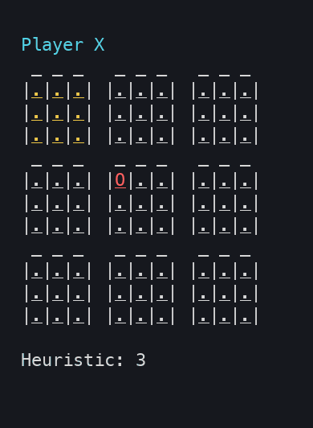

# Minimax Ultimate Tic-Tac-Toe

An AI that plays [ultimate tic-tac-toe](https://en.wikipedia.org/wiki/Ultimate_tic-tac-toe) in the terminal, using minimax with alpha-beta pruning. Coded by hand before AI.

<p align="center">
  
  <br>
  <em>Minimax (O) against a random player (X). The yellow grid is where the next move has to be played.</em>
</p>

## How it works

Everything is in [`minimax_ultimate_tictactoe.py`](minimax_ultimate_tictactoe.py).

**Search.** The AI explores the game tree 5 moves ahead with minimax: O picks the move that maximizes the evaluation, assuming that X then picks the one that minimizes it, and so on. Moves are played and undone in place on the board, with a stack to remember in which small grid the next move has to be played. Alpha-beta pruning cuts the branches that cannot change the result.

**Evaluation.** At depth 5 the game is usually not over, so the position gets a heuristic score. On a $3 \times 3$ board $b$, each row, column and diagonal gives a player 1, 10 or 100 points if they have 1, 2 or 3 marks on it, and $s_p(b)$ is the sum for player $p$. We add the scores of the 9 small grids $g$, and of the big grid $B$ with a weight of 5:

```math
\text{eval} = \sum_{g} \left( s_O(g) - s_X(g) \right) + 5 \left( s_O(B) - s_X(B) \right)
```

## Run

No dependencies, just Python.

```bash
python minimax_ultimate_tictactoe.py
```

Each player can be a human (1), the minimax AI (2) or a random player (3).
